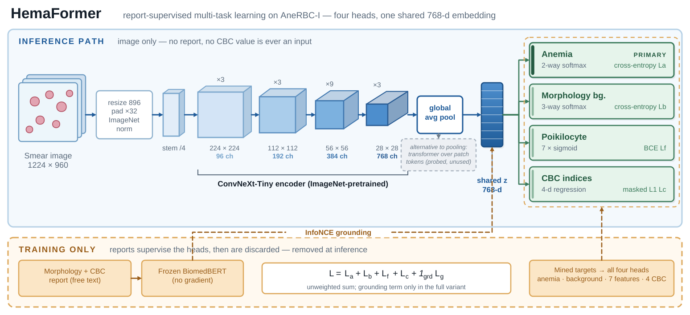
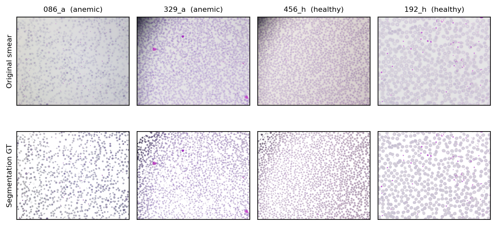
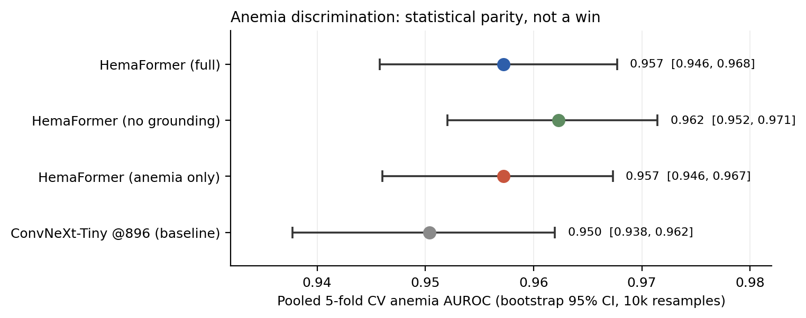
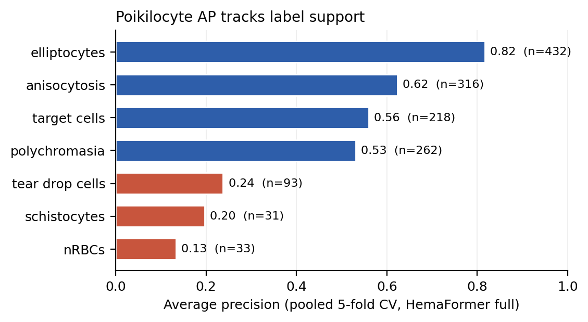
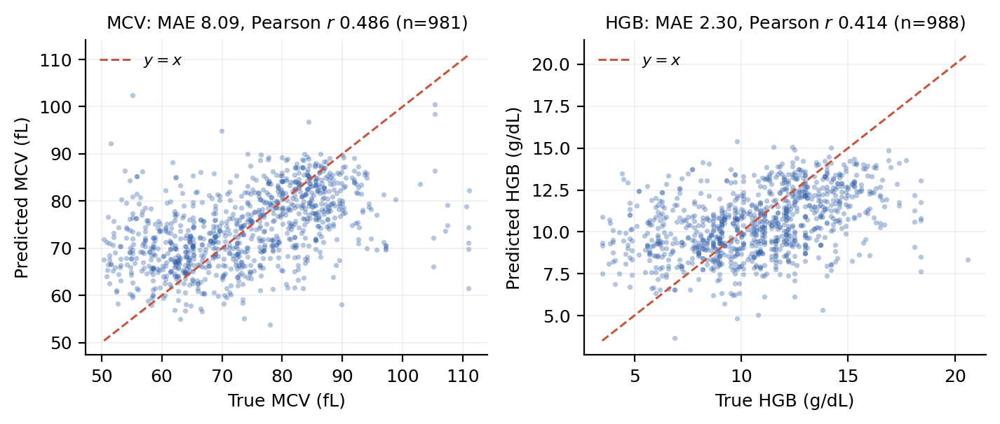
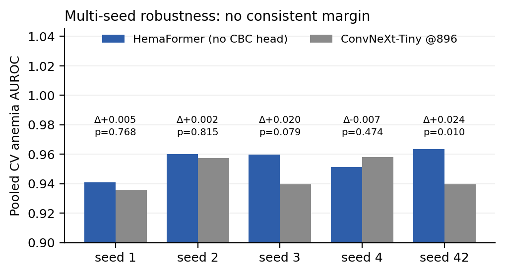
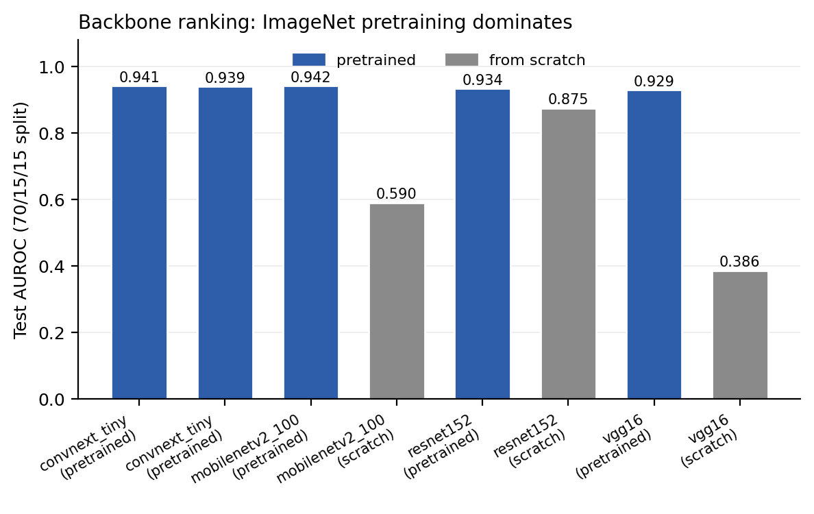
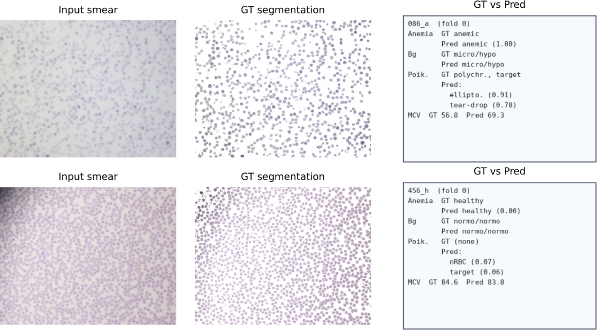
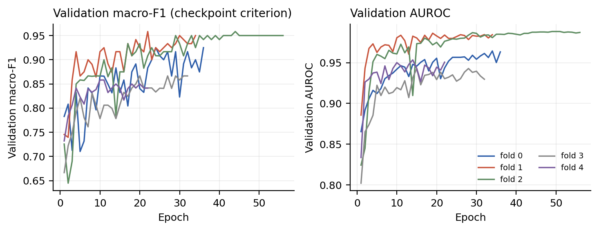

[](https://amictconf.com/index.html)
[](https://doi.org/10.1093/database/baae120)

# HemaFormer: Report-Supervised Multi-Task Learning for Anemia and RBC Morphology

Official implementation of **"HemaFormer: Report-Supervised Multi-Task Learning for Anemia and RBC
Morphology on AneRBC"**, accepted at the *3rd International Conference on Advances in Machine
Intelligence and Cybersecurity Technologies (AMICT 2026)*, Labuan, Malaysia, 12–13 November 2026.

**Talal Ahmad**<sup>1</sup> · **Husnain Abid**<sup>2</sup> · **Ghulam Arbi**<sup>3,\*</sup>

<sup>1</sup>Department of Computer Engineering, Bahauddin Zakariya University, Multan, Pakistan ·
<sup>2</sup>Department of Computer Science, University of South Wales, UK ·
<sup>3</sup>Department of Computer Science, University of Science and Technology of China, China

\*Corresponding author — [arbi@mail.ustc.edu.cn](mailto:arbi@mail.ustc.edu.cn)

---

## Overview

This repository contains the full code, the **report-mined label set**, the **fixed 5-fold split**
and every **result table/figure** of the paper. Free-text CBC and morphology reports are used *only*
to build training supervision — **at inference the model sees the smear image alone**.

What you get here:

- **A reproducible benchmark on AneRBC-I**: a fixed, seeded, stratified 5-fold split (each of the
  1,000 smears is a test sample exactly once) plus labels mined from the paired reports —
  3-way morphology background, 7 binary poikilocyte features, and range-masked CBC indices.
- **HemaFormer**: an ImageNet-pretrained ConvNeXt-Tiny encoder, global average pooling, and four
  lightweight heads (anemia · morphology background · poikilocytes · CBC regression), with an
  optional training-only InfoNCE grounding branch against a frozen BiomedBERT encoding of the
  morphology report.
- **Calibrated negative results**: with 10,000-resample bootstrap CIs, neither contrastive
  grounding nor auxiliary multi-task supervision significantly improves the (near-saturated)
  anemia AUROC at this data scale. The paper reports parity, not a win — and so does this README.
- **Everything needed to regenerate the numbers and figures** without retraining: pooled
  predictions, per-fold histories, bootstrap/DeLong statistics.

### Results at a glance

| Property | Value |
|---|---|
| Data | AneRBC-I — 1,000 smears (500 anemic / 500 healthy), 1224×960 |
| Protocol | Fixed stratified 5-fold CV (seed 42), pooled held-out predictions |
| Anemia AUROC | **0.957** [0.946, 0.968] (HemaFormer, full) |
| vs. ConvNeXt-Tiny@896 | **0.950** [0.938, 0.962] → Δ +0.007, 95% CI includes 0 → *parity* |
| Anemia accuracy @ tuned threshold | 0.884 [0.863, 0.903] |
| Morphology background (macro-F1) | 0.607 |
| Poikilocyte multi-label (mAP / supported) | 0.442 / **0.632** (classes with n ≥ 100) |
| CBC regression (masked MAE) | HGB 2.30 g/dL · MCV **8.09 fL** · MCH 3.25 pg · MCHC 1.98 g/dL |
| Compute | 1× NVIDIA RTX 3060 (12 GB), ≈30 s/epoch at long-side 896 |

### What is (and is not) in this repo

| Included | Not included |
|---|---|
| `src/` — model, data module, training, CV study, baselines | ❌ The AneRBC dataset (download it, see [Dataset](#dataset)) |
| `artifacts/` — manifest, mined labels, fixed split & folds | ❌ Model checkpoints (`.pt`, 0.2–0.6 GB each — see [Checkpoints](#checkpoints)) |
| `runs/` — all result CSVs, per-fold JSON, bootstrap stats | ❌ Paper LaTeX source / PDF (camera-ready is distributed by the conference) |
| `figures/` — every figure in this README | ❌ Raw AneRBC-II crops (not used in the paper) |

---

## Architecture



The smear is resized to long-side 896, padded to a multiple of 32 and ImageNet-normalised, then
encoded by ConvNeXt-Tiny. Global average pooling produces a single 768-d smear embedding `z`, which
feeds four linear heads:

| Head | Output | Loss |
|---|---|---|
| Anemia | 2-way logits | cross-entropy |
| Morphology background | 3-way logits (microcytic-hypochromic / normocytic-normochromic / other) | cross-entropy |
| Poikilocyte features | 7 logits (sigmoid) | binary cross-entropy |
| CBC indices | 4-d regression (HGB, MCV, MCH, MCHC) | masked L1 |

Total loss is the unweighted sum `L = L_a + L_b + L_f + L_c + 1[grd]·L_g`, where the optional
grounding term `L_g` is InfoNCE between `z` and a frozen BiomedBERT encoding of the morphology
report. The whole report path — and every CBC value — is removed at test time.

> **Note on the transformer branch.** `src/model.py` still contains the population
> self-attention variant (ConvNeXt patch tokens + `TransformerEncoder`, `use_transformer=True`).
> It is the *probe* discussed in the paper, **not** the primary model. All headline numbers use the
> global-pool recipe (`use_transformer=False`), which is what the `gp_*` configs in
> `src/run_cv_study.py` instantiate. If BiomedBERT weights are unavailable, grounding is disabled
> automatically and training continues.

---

## Dataset

We evaluate on the public **AneRBC-I** subset of the AneRBC dataset
(*Shahzad et al., "AneRBC dataset: a benchmark dataset for computer-aided anemia diagnosis using
RBC images", Database, 2024* — [doi:10.1093/database/baae120](https://doi.org/10.1093/database/baae120)).
We do **not** redistribute it; download it from the link in that paper and place it as:

```text
HemaFormer/
└── AneRBC_dataset/
    └── AneRBC-I/
        ├── Anemic_individuals/
        │   ├── Original_images/        # 500 × 1224×960 PNG
        │   ├── Binary_segmented/       # dataset GT (not used as a model target)
        │   ├── RGB_segmented/          # dataset GT (not used as a model target)
        │   ├── CBC_reports/            # 500 × .txt panels
        │   └── Morphology_reports/     # 500 × .txt narratives
        └── Healthy_individuals/        # same layout, 500 each
```



*Original smears (top) and the dataset's segmentation ground truth (bottom). The masks ship with
AneRBC but are not used as training targets in this work; reports are never inputs.*

### Benchmark released with this paper

Everything below is produced deterministically by `src/build_anerbc_i_labels.py` +
`src/run_cv_study.py --build-folds-only` and committed under [`artifacts/`](artifacts):

| Quantity | Value |
|---|---|
| Images (AneRBC-I) | 1,000 |
| Anemia (anemic / healthy) | 500 / 500 |
| Per-fold train / val / test | 680 / 120 / 200 |
| Morphology background | microcytic-hypochromic 455 · normocytic-normochromic 420 · other 125 |
| Poikilocyte positives | elliptocytes 432 · anisocytosis 316 · polychromasia 262 · target cells 218 · tear-drop 93 · nRBCs 33 · schistocytes 31 |
| CBC valid / masked | HGB 988/12 · HCT 981/19 · MCV 981/19 · MCH 929/71 · MCHC 942/58 · RDW-CV 633/367 · RBC 965/35 |

The regression head uses **HGB, MCV, MCH, MCHC** only. Anemia labels come from the dataset cohort
tag — not from a WHO haemoglobin cut-off — and HGB is never an input. Full mining rules, physiologic
ranges and per-split counts are in [docs/DATASET.md](docs/DATASET.md).

---

## Results

All numbers are **pooled 5-fold CV** over the 1,000 AneRBC-I images (unless a row says otherwise),
with bootstrap 95% CIs from 10,000 resamples. Decision thresholds are tuned on each fold's
validation split (macro-F1) and then applied to that fold's test predictions.

### 1. Anemia classification: statistical parity, not a win



| Config | AUROC [95% CI] | Acc @ tuned thr [95% CI] | Mean thr |
|---|---|---|---|
| **HemaFormer (full)** | **0.957** [0.946, 0.968] | 0.884 [0.863, 0.903] | 0.45 |
| HemaFormer (no grounding) | 0.962 [0.952, 0.971] | 0.884 [0.863, 0.903] | 0.44 |
| HemaFormer (anemia-only) | 0.957 [0.946, 0.967] | 0.874 [0.853, 0.894] | 0.50 |
| ConvNeXt-Tiny @896 (baseline) | 0.950 [0.938, 0.962] | 0.853 [0.831, 0.875] | 0.53 |

Paired bootstrap contrasts on the same test predictions:

| Contrast | Δ AUROC | 95% CI | CI excludes 0? |
|---|---|---|---|
| Grounding (full − no grounding) | −0.0051 | [−0.0108, 0.0008] | **No** |
| Multi-task (full − anemia-only) | −0.0000 | [−0.0062, 0.0060] | **No** |
| vs. baseline (full − ConvNeXt@896) | +0.0069 | [−0.0028, 0.0168] | **No** |

**Reading:** at AneRBC-I scale a strong pretrained backbone already saturates anemia AUROC, so the
honest conclusion is parity. We deliberately do not claim an anemia win.

### 2. What prior AneRBC models do not produce: morphology and CBC from the image

| Task / metric | HemaFormer (full) |
|---|---|
| Morphology background (macro-F1) | 0.607 |
| Poikilocyte features (mAP, all 7) | 0.442 |
| Poikilocyte features (mAP, n ≥ 100) | 0.632 |
| HGB MAE (g/dL), n = 988 | 2.30 |
| **MCV MAE (fL), n = 981** | **8.09** |
| MCH MAE (pg), n = 929 | 3.25 |
| MCHC MAE (g/dL), n = 942 | 1.98 |



Per-class AP tracks label support monotonically: well-represented findings (elliptocytes,
anisocytosis, target cells) are learned, while nRBCs (n = 33) and schistocytes (n = 31) remain
support-limited and should be read cautiously.



### 3. Multi-seed robustness of the contrast

Five seeds (42, 1, 2, 3, 4), same folds: HemaFormer (no CBC head) 0.9550 ± 0.0091 vs.
ConvNeXt-Tiny@896 0.9460 ± 0.0108; mean AUROC gap +0.0090 with pooled-bootstrap 95% CI
**[−0.0047, 0.0226]** → includes zero. Only one of five seeds reaches DeLong p < 0.05
(seed 42, p = 0.0096; the others 0.079 ≤ p ≤ 0.815).



### 4. Diagnostic backbone ranking (single 70/15/15 split, test n = 150)

Used only to rank backbones — **not** comparable to the pooled CV table above.



| Model | Init | Long side | Acc | P | R | F1 | AUROC |
|---|---|---|---|---|---|---|---|
| ConvNeXt-Tiny | pretrained | 512 | 0.867 | 0.923 | 0.800 | 0.857 | 0.941 |
| ConvNeXt-Tiny | pretrained | 896 | 0.853 | 0.853 | 0.853 | 0.853 | 0.939 |
| MobileNetV2 | pretrained | 512 | 0.853 | 0.819 | 0.907 | 0.861 | 0.942 |
| MobileNetV2 | scratch | 512 | 0.553 | 0.551 | 0.573 | 0.562 | 0.590 |
| ResNet-152 | pretrained | 512 | 0.820 | 0.800 | 0.853 | 0.826 | 0.934 |
| ResNet-152 | scratch | 512 | 0.807 | 0.897 | 0.693 | 0.782 | 0.875 |
| VGG-16 | pretrained | 512 | 0.860 | 0.897 | 0.813 | 0.853 | 0.929 |
| VGG-16 | scratch | 512 | 0.500 | 0.500 | 1.000 | 0.667 | 0.386 |

### 5. Architecture probe: attention vs. pooling (same 70/15/15 split)

| Variant (`src/train_method.py --tag`) | AUROC | Acc | Bg macro-F1 | Feature mAP | HGB MAE | MCV MAE |
|---|---|---|---|---|---|---|
| `full` (patch tokens + TransformerEncoder) | 0.936 | 0.827 | 0.603 | 0.468 | 2.33 | 8.06 |
| `no_transformer` (global pooling — primary) | **0.963** | **0.887** | **0.647** | 0.468 | 2.48 | 7.94 |
| `no_grounding` | 0.946 | 0.880 | 0.615 | 0.470 | 2.67 | 8.29 |
| `no_cbc` | 0.923 | 0.840 | 0.598 | 0.456 | — | — |
| `anemia_only` | 0.939 | 0.833 | — | — | — | — |

This is a *preliminary probe* on a single split (no CI), reported for completeness; the paper keeps
global pooling as the primary design and makes no quantitative transformer claim.

### 6. Qualitative predictions on held-out smears



Each row uses the CV-fold checkpoint that never trained on that stem. Columns: input smear, dataset
segmentation GT, and GT vs. predicted (anemia, morphology background, top-2 poikilocytes, MCV).

### 7. Training dynamics (5 folds of HemaFormer full)



---

## Installation

```bash
git clone https://github.com/aiguo112/HemaFormer.git
cd HemaFormer

# Option A — conda (recommended)
conda env create -f environment.yml
conda activate hemaformer

# Option B — pip into an existing environment
pip install -r requirements.txt
# make sure torch/torchvision match your CUDA driver, e.g.
# pip install torch torchvision --index-url https://download.pytorch.org/whl/cu124
```

Requirements: Python ≥ 3.10, PyTorch ≥ 2.4 with CUDA, `timm`, `scikit-learn`, `pandas`,
`matplotlib`, and `transformers` (only for the grounding branch). The reported runs used a single
NVIDIA RTX 3060 (12 GB). A GPU is required for training; `scripts/make_figures.py` runs on CPU.

---

## Reproducing the paper

All commands are run **from the repository root**, after placing `AneRBC_dataset/` there.

```bash
# 1) Mine labels + 70/15/15 split from the reports  ->  artifacts/*.csv
python -m src.build_anerbc_i_labels

# 2) Build the fixed stratified 5-fold split        ->  artifacts/folds.csv
python -m src.run_cv_study --build-folds-only

# 3) Main result: pooled 5-fold CV (4 configs × 5 folds)  ->  runs/method/cv_results.csv
python -m src.run_cv_study \
    --configs gp_full,gp_no_grounding,gp_anemia_only,convnext@896 \
    --folds 0,1,2,3,4

# 4) Single-split architecture probe (Table 5)
python -m src.train_method --ablation          # or: --tag no_transformer

# 5) Baselines on the 70/15/15 split               ->  runs/baselines.csv
python -m src.run_baselines --mode full        # train all 8 rows from scratch/pretrained

# 6) Global-pool attribution + multi-seed robustness -> runs/method/robustness*.csv
python -m src.run_gp_study --part all --seeds 42,1,2,3,4

# 7) Rebuild every figure in this README            ->  figures/fig_*.png
python scripts/make_figures.py
```

Useful flags:

- `src.run_cv_study` — `--configs ...`, `--folds 0,1,2,3,4`, `--no-skip-existing` (retrain
  instead of reusing `runs/method/cv/<config>/fold<k>/`), `--rebuild-csv-only` (re-aggregate
  existing fold outputs without training).
- `src.train_method` — `--tag {full,no_grounding,no_cbc,anemia_only,no_transformer}`,
  `--no-grounding`, `--no-cbc_head`, `--long-side 896`, `--max-epochs 60`.
- `src.run_baselines` — `--mode {full,fix_extend,convnext_hires}`, `--epochs`, `--patience`.
- `src.run_gp_study` — `--part {a,b,all}`, `--winner <tag>`, `--seeds 42,1,2`.
- `src.eval_baselines` — re-scores existing checkpoints into `runs/baselines.csv`; set
  `SKIP_MISSING_RESNET152_PRETRAINED=1` to skip the optional ResNet-152 training step.

Hardware note: one CV fold is 10–25 min (≈30 s/epoch at long-side 896, batch 4 × grad-accum 6), so
the full four-config grid is a few GPU-hours. Every run writes `config.json`, `history.json` and
`results.json` next to its checkpoint, which is why the shipped `runs/` tree lets you rebuild all
tables and figures without retraining.

---

## Repository layout

```text
HemaFormer/
├── src/
│   ├── model.py                 # HemaFormer: ConvNeXt-Tiny + pooling/transformer + 4 heads
│   ├── data.py                  # AneRBC-I dataset, transforms, CBC cleaning, fold loaders
│   ├── build_anerbc_i_labels.py # report mining: background, poikilocytes, CBC, split
│   ├── train_method.py          # single-run trainer + ablation grid (VAL-tuned thresholds)
│   ├── run_cv_study.py          # pooled 5-fold CV + bootstrap CIs + contrasts
│   ├── run_gp_study.py          # global-pool attribution (Part A) + multi-seed (Part B)
│   ├── run_baselines.py         # 8-backbone baseline sweep (70/15/15 split)
│   └── eval_baselines.py        # re-score existing baseline checkpoints
├── artifacts/                   # benchmark: manifest, mined labels, split, folds
├── runs/                         # result CSVs/JSON (no weights) — see docs/REPRODUCIBILITY.md
├── figures/                     # all figures used in this README
├── scripts/make_figures.py      # regenerates the data figures from runs/
├── docs/
│   ├── DATASET.md               # mining rules, ranges, per-split counts
│   └── REPRODUCIBILITY.md       # exact protocol, environments, per-fold numbers
├── requirements.txt
├── environment.yml
├── CITATION.cff
└── LICENSE
```

Key files under `runs/`:

| Path | Contents |
|---|---|
| `runs/method/cv_results.csv` | pooled CV table + per-fold rows + bootstrap contrasts |
| `runs/method/ablation.csv` | single-split ablation grid (Table 5) |
| `runs/method/gp_ablation.csv` | global-pool ablation grid, same split |
| `runs/method/robustness*.csv/json` | 5-seed AUROC gaps, DeLong tests, bootstrap CI |
| `runs/method/cv/<config>/fold<k>/` | `config.json`, `history.json`, `results.json`, `test_scores.npz` (+ `aux_arrays.npz` for method configs) |
| `runs/method/cv/preds_cbc.csv` | pooled CBC predictions (drives the scatter figure) |
| `runs/baselines.csv` | the 8-row diagnostic baseline table |
| `runs/cbc_stats.json` | train-split mean/std used to z-score CBC targets |

### Checkpoints

Trained weights are **not** committed (each `best.pt` is 0.2–0.6 GB). Either retrain with the
commands above, or attach the weights to a GitHub Release and unpack them next to their run
directories — `runs/method/cv/<config>/fold<k>/best.pt` for the CV study,
`runs/method/<tag>/best.pt` for single runs — where the scripts pick them up automatically
(`--skip-existing` reuses fold checkpoints).

---

## Notes and gotchas

- **Reports are supervision only.** Their labels are mined before training; no report text, and no
  CBC value, enters the model at inference. This is what keeps the anemia number honest (HGB alone
  would nearly solve the task).
- **`artifacts/*.csv` are the canonical, Linux-generated files** (LF endings, `/` separators).
  Regenerating them on Windows reproduces the same values but writes CRLF endings and `\` path
  separators in the `*_path` columns — harmless, since the loader uses `pathlib`.
- **CBC masking** is physiologic-range based; RDW-CV is masked in 367/1,000 cases and is *not* a
  regression target. Masked entries contribute zero gradient.
- **Thresholds** are tuned per fold on validation macro-F1; AUROC is threshold-free. Do not mix
  `acc@thr` across protocols (single split vs. pooled CV).
- **AneRBC-II is not used** in this paper. Its reports are per parent case, not per crop, so tile →
  report linkage is ambiguous.
- The dataset ships *visualisation* masks with continuous RGB values, not discrete per-cell
  morphology class maps; per-cell morphology labels do not exist in AneRBC. All morphology
  supervision here is mined from the text reports at image level.

---

## Citation

If you use this code, the mined labels or the fixed split, please cite:

```bibtex
@inproceedings{ahmad2026hemaformer,
  title     = {HemaFormer: Report-Supervised Multi-Task Learning for Anemia and {RBC}
               Morphology on {AneRBC}},
  author    = {Ahmad, Talal and Abid, Husnain and Arbi, Ghulam},
  booktitle = {2026 3rd International Conference on Advances in Machine Intelligence and
               Cybersecurity Technologies (AMICT)},
  address   = {Labuan, Malaysia},
  year      = {2026},
  note      = {Accepted}
}
```

The AneRBC dataset itself must be cited separately:

```bibtex
@article{shahzad2024anerbc,
  title   = {{AneRBC} dataset: a benchmark dataset for computer-aided anemia diagnosis using
             {RBC} images},
  author  = {Shahzad, Muhammad and Shirazi, Syed Hamad and Yaqoob, Muhammad and Khan, Zakir
             and Rasheed, Assad and Sheikh, Israr Ahmed and Hayat, Asad and Zhou, Huiyu},
  journal = {Database},
  volume  = {2024},
  pages   = {baae120},
  year    = {2024},
  doi     = {10.1093/database/baae120}
}
```

---

## License

Code released under the [MIT License](LICENSE). The AneRBC dataset keeps its own license — see the
dataset publication. This is a research prototype and **not** a medical device; do not use it for
clinical decision-making.

## Acknowledgements

We thank the AneRBC authors for releasing the dataset with paired CBC and morphology reports, and
the AMICT 2026 reviewers for their feedback.
